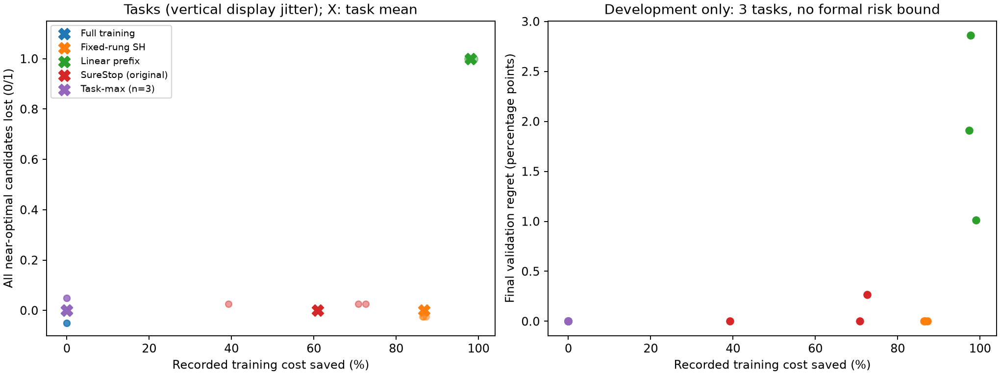
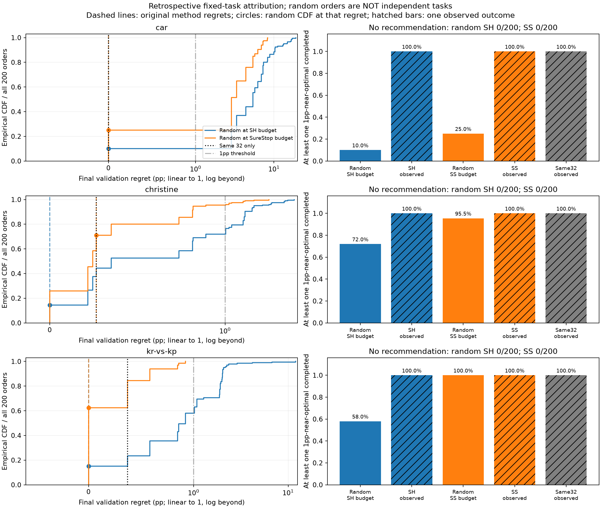

# LCStop: learning-curve stopping method evaluation

[中文](README.md) | English

> Public research artifact, 2026-11-08. This repository presents a reproducible method-evaluation and attribution case study.
> [Public-release checks](public_release_v1/README.md) · [License scope](LICENSE_SCOPE.md).
> Earlier reports referring to PRIVATE describe the repository at that historical stage.

**Status: development demonstrations and bounded attribution are complete. The current new-algorithm claim is stopped; no formal test evaluation has begun.**

LCStop asks whether validation learning-curve prefixes can reduce recorded training costs while retaining at least one near-optimal configuration in a fixed candidate pool.
This is a personal research artifact. It does not claim a new algorithm, a published paper, independent external validation, or universal superiority.
The fixed development records were deterministically replayed in a fresh package environment on 2026-11-06. No new models were trained.

## Reading order

1. [Research note, Chinese](research_note.md): question, nearest-work audit, development demonstration, unit correction and stopping decision.
2. [Final attribution addendum, Chinese](analysis_addendum_v1/addendum.md): the 32 completed candidates and matched-cost random training.
3. [Fixed pilot rules](pilot_rules.md) and [original historical running instructions](README_research_original.md).
4. [Main results](results/pilot_results.json), [per-task CSV](results/per_task.csv), [attribution CSV](analysis_addendum_v1/attribution.csv) and [random comparison rows](analysis_addendum_v1/random_budget_comparison.csv).
5. [Reproduction guide](docs/REPRODUCIBILITY.md), [data and sources](docs/DATA_AND_SOURCES.md) and [publication-copy changes](publication/RELEASE_NOTES.md).
6. [Clean-environment replay report, Chinese](reproduction_review_v1/README.md) and [method-evaluation case note, Chinese](reproduction_review_v1/method_evaluation_note.md).

## Fixed data, candidates and outcomes

The source is the official LCBench three-seed archive, version1.
Six development tasks were selected using metadata and a fixed SHA256 ordering, without replacing tasks based on terminal performance.
volkert, higgs and mfeat-factors are development calibration-diagnostic tasks.
**car, christine and kr-vs-kp** are the three main development demonstration tasks.
Each task has 128 preselected configurations and three recorded training seeds from the same planned 50-epoch experiment.
Seeds are repeated records of a configuration, not independent tasks.

The bundled cache contains only these six previously used tasks, configuration metadata, five validation checkpoints and recorded costs.
It contains no test metrics. No formal test pool exists.

- Loss is **100 × (1 − validation balanced accuracy fraction)**, in **percentage points (pp)**; lower is better.
- Configuration performance is the mean over its three recorded seeds; cost is their summed cumulative elapsed seconds.
- The common endpoint is epoch50. Checkpoints are 1 / 5 / 15 / 30 / 50.
- A configuration is 1pp-near-optimal when its final mean loss is at most the minimum final loss in that task's fixed 128-candidate pool plus 1pp.
- Task failure means that no near-optimal candidate completes the common endpoint. The final recommendation is selected using final validation loss among completed candidates.
- SureStop uses alpha=.1 and an absolute good threshold tau=20pp. Its single-configuration good event differs from task-relative 1pp near-optimality.
- Costs are the original recorded elapsed seconds, potentially including evaluation/logging overhead. They are **not measured training speedups on the reproduction machine** or pure training CPU time.

Policies receive only paid validation prefixes through a restricted interface. Hidden endpoints are held by the offline evaluator.
Each strategy receives its own worker and payment ledger; the interface is not an OS sandbox against malicious Python code.

## Main development results

Sources: [saved valid summary](results/pilot_results.json) and [per-task CSV](results/per_task.csv).
Cost savings are normalized against full training within each task and then averaged equally over the three demonstration tasks.

| Strategy | Recorded cost saved | All near-optimal candidates lost | Mean final validation regret, pp |
|---|---:|---:|---:|
| Full training | 0.00% | 0/3 | 0.00000 |
| Fixed-rung Successive Halving (SH) | 86.76% | 0/3 | 0.00000 |
| Simple linear prefix extrapolation | 98.07% | 3/3 | 1.92724 |
| Original SureStop core | 60.90% | 0/3 | 0.08830 |
| Task-maximum score, infinity fallback | 0.00% | 0/3 | 0.00000 |

SH is a fixed-checkpoint adaptation, not a complete Hyperband implementation.
The three calibration tasks are insufficient for a nontrivial finite-sample 90% task-level quantile; the task-maximum rule therefore performs no pruning.
Its online actions coincide with full training, so it is not counted as a distinct effective stopping algorithm.
The simple prefix rule's large savings come with failure on all three demonstration tasks.
Zero observed task failures do not establish a population risk guarantee.

### Final attribution

The initial **32 fully paid SureStop calibration candidates already retained at least one 1pp-near-optimal configuration in every demonstration task**.
This alone is sufficient to explain the original 0/3 task-loss result.
Those 32 candidates remain eligible for final selection; the addendum does not remove them from the original method.

| Task | Additional final-regret improvement from later96, pp | Additional recorded cost, seconds |
|---|---:|---:|
| car | 0.000000 | 541.436 |
| christine | 0.000000 | 705.792 |
| kr-vs-kp | 0.371357 | 9987.732 |

The matched-cost random baseline uses the same 128 candidates, 200 fixed permutations per task and seed20261030.
The two budgets come from each task's saved actual SH and SureStop costs.
The random policy cannot inspect terminal quality or future costs to order or skip candidates.
If the next candidate cannot complete within the remaining budget, the remaining budget is spent, its endpoint is withheld, and the trial stops.
Zero-completion trials remain no-recommendation failures.

| Budget reference | car: near-optimal retention | christine | kr-vs-kp |
|---|---:|---:|---:|
| Actual SH cost | 10.0% | 72.0% | 58.0% |
| Actual SureStop cost | 25.0% | 95.5% | 100.0% |

SH achieved zero pool-relative validation regret in all three fixed pools and showed a selection advantage over matched-cost random full training.
The later96 candidates improved SureStop's final regret only on kr-vs-kp.
This is **retrospective budget matching and contribution decomposition, not an identified causal effect of prefix information or a population risk guarantee**.
Random permutations are not additional independent tasks. Calibration costs are included.

## Installation and reproduction

Python3.12 is recommended; the recorded environment is in [environment.json](sources/environment.json).
A fresh venv without system-site-packages successfully installed the pinned core dependencies from official PyPI using uv on 2026-11-06.
Both small-cache wrapper commands below were actually executed successfully on the same Windows host.
The conventional pip installation command below was not separately retested; cross-platform execution remains unverified.
Use your own environment and leave the original research environment unchanged.

~~~powershell
python -m venv .venv
.\.venv\Scripts\python.exe -m pip install -r requirements-replay.txt

# A: replay the pilot from the bundled, previously used small cache
.\.venv\Scripts\python.exe -B tools/reproduce.py pilot --name pilot_replay_01

# A: replay the same fixed attribution orders; no additional observations
.\.venv\Scripts\python.exe -B tools/reproduce.py addendum --name attribution_replay_01
~~~

Outputs go to the ignored reproductions/ directory; existing run names are rejected.
The pilot reproduces all 30 task-strategy runs with exact scientific-output equality under the predeclared timing-field exclusions.
Four attribution data files were byte-identical. These are deterministic repetitions of exposed development data, not new validation.

[Detailed instructions](docs/REPRODUCIBILITY.md) distinguish:
- **A: bundled-cache replay**, now actually verified in a fresh package environment on the same host;
- **B: reconstruction from the official raw archive**, documented but not rerun end-to-end after the unit correction.

The current v2 cache was recovered from the preserved first-attempt cache.
Its provenance and arithmetic-precision limits remain in [unit_correction.json](sources/unit_correction.json).
The invalid first attempt remains in [results/attempt_01_unit_fail](results/attempt_01_unit_fail/pilot_results.json) and [its figures](figures/attempt_01_unit_fail/risk_cost.png).
It is not used as a valid performance result.

The approximately1.81GB archive, virtual environments, paper PDFs, model weights and complete external repositories are excluded.
The official archive's version, exact size, SHA256, download URL, destination and generator scripts are listed in [data documentation](docs/DATA_AND_SOURCES.md).
There are no automatic training/download workflows, CI jobs or paid storage workflows.

## Data, third parties and licensing

- [LCBench](https://github.com/automl/LCBench): Zimmer, Lucas (2020), data_2k_3seed, [version1 DOI](https://doi.org/10.6084/m9.figshare.12408707.v1).
- The six-task cache is a selected and unit-transformed derivative of that Apache-2.0 dataset. The [license text](licenses/LCBench-Apache-2.0.txt), attribution and [transformation record](sources/unit_correction.json) are retained.
- Only the required, byte-pinned [SureStop core](sources/repos/ACNoonan/surestop/src/surestop/core.py) is bundled, with its copyright and [MIT license](sources/repos/ACNoonan/surestop/LICENSE). Other reviewed works are referenced through reading-scope records, source URLs and historical hashes.
- **No repository-wide open-source license has been selected for original LCStop code or writing.** Public visibility does not add an MIT or other blanket license. Third-party licenses retain their own scope. See [LICENSE_SCOPE.md](LICENSE_SCOPE.md) and [THIRD_PARTY_NOTICES.md](THIRD_PARTY_NOTICES.md).

## Contributions and claim limits

高书伦 defined the research objectives, constraints and acceptance requirements and authorized the development demonstration and attribution analysis.
Implementation, source review, reporting and publication preparation involved AI execution and assistance; this is not presented as entirely hand-written code.
The project does not contain a file-by-file human contribution ledger, so manual coding proportions and line-level authorship are not inferred.
Computational review is not independent experimental validation.
SureStop code, LCBench data and neighboring theory belong to their respective authors.

The artifact demonstrates causal information visibility, strong baselines, explicit failures, unit correction and cost attribution.
Under the fixed workflow, loss of all near-optimal candidates coincides with an existing epsilon-simple-regret event.
Ordinary LTT/maximum-score methods already provide direct risk-control frameworks; the current work does not establish a new algorithm.
No claim is made about biological validity in any earlier project.
