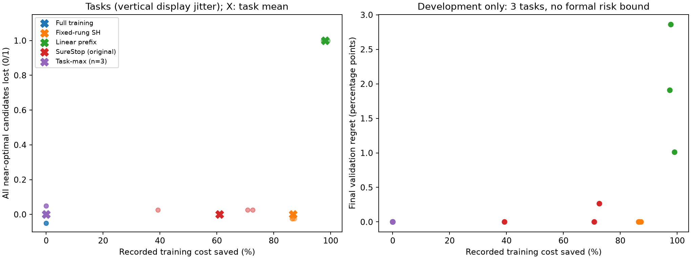
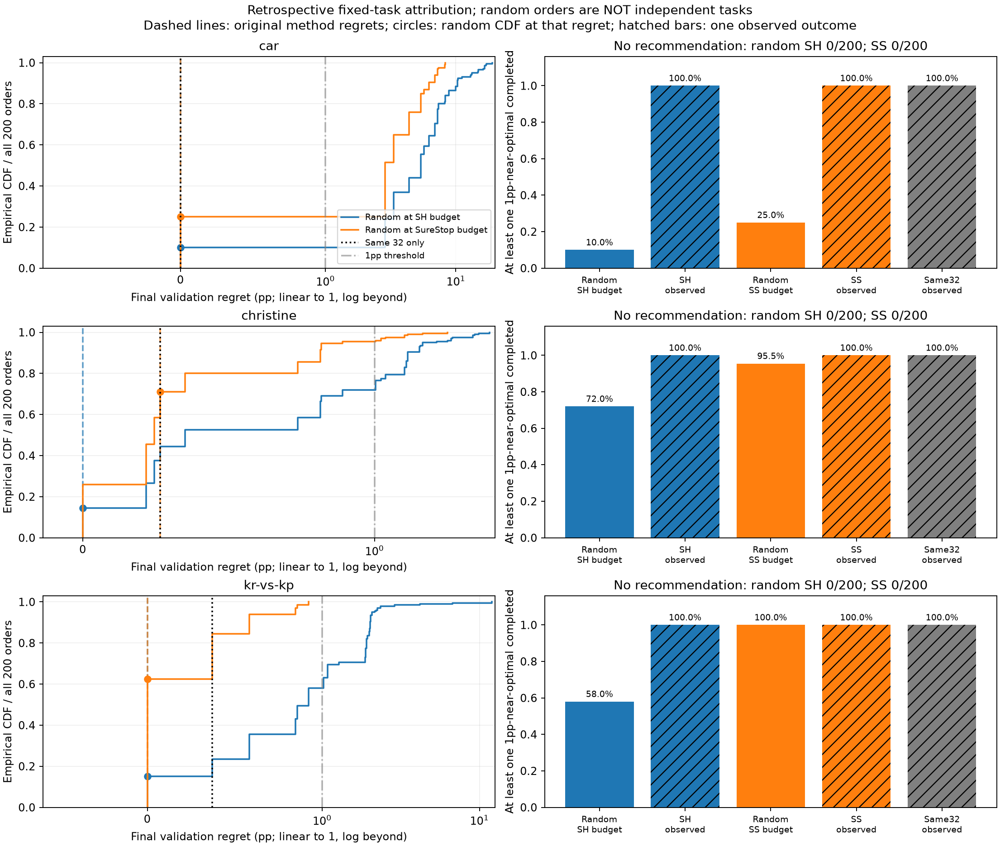

# LCStop: learning-curve stopping method evaluation

学习曲线前缀早停的可运行复现与方法评估。问题是：能否节省记录训练成本，同时保留固定候选池中的至少一个近优配置？

**状态：已完成开发演示与限定归因补充；停止当前新算法主张，未进入正式测试。**
这是私人研究归档，不声称新算法、已发表论文、正式外部验证或普遍优越性。所有结果均来自已有记录；本次发布没有重跑策略、训练或评价。

## 先读什么

1. [研究笔记](research_note.md)：问题、近邻文献、六任务开发小试、单位纠错和停止决定。
2. [最后的归因补充](analysis_addendum_v1/addendum.md)：32个已完成候选与同成本随机训练对照。
3. [固定规则](pilot_rules.md)、[原运行说明](README_research_original.md)。
4. [主结果](results/pilot_results.json)、[逐任务表](results/per_task.csv)、[归因表](analysis_addendum_v1/attribution.csv)、[随机比较逐次结果](analysis_addendum_v1/random_budget_comparison.csv)。
5. [复现说明](docs/REPRODUCIBILITY.md)、[数据与许可](docs/DATA_AND_SOURCES.md)、[发布修改与排除记录](publication/RELEASE_NOTES.md)。

## 固定数据与对象

LCBench官方三种子归档v1。六个任务由元数据加固定SHA256规则选出，未按后段表现替换。
volkert、higgs、mfeat-factors是开发校准诊断任务；**car、christine、kr-vs-kp**是三个主要开发演示任务。
每任务128配置，使用原50轮计划实验中的三个记录训练种子；三个种子是同一配置的重复记录，不是三个独立任务。
仓库缓存只保留上述六任务、五节点的验证指标、成本和配置元数据，不含测试指标。没有正式测试池。

- 误差：100 × (1 − validation balanced accuracy fraction)，单位**百分点（pp）**，越低越好。
- 配置表现：三个记录种子的误差平均；配置成本：三个种子的累计elapsed seconds相加。
- 共同终点：epoch50；观察节点：1 / 5 / 15 / 30 / 50。
- 1pp近优：相对同任务预定128配置池的最低终点误差，差≤1pp。
- 任务丢失事件：没有近优候选完成共同终点。完成候选中按终点验证误差选择。
- SureStop α=.1、绝对good阈值τ=20pp；该单配置good事件不同于任务内1pp近优。
- 成本包含原记录的评价/记录开销，**不是本机实测训练加速**，也不是纯训练CPU时间。

## 主要开发结果

来源：[已有有效汇总](results/pilot_results.json)和[逐任务CSV](results/per_task.csv)。
成本节省先按各任务全训练成本归一，再对三个演示任务等权。

| 策略 | 记录成本节省 | 全部近优丢失 | 平均最终验证遗憾pp |
|---|---:|---:|---:|
| 全部训练 | 0.00% | 0/3 | 0.00000 |
| 固定节点Successive Halving（SH） | 86.76% | 0/3 | 0.00000 |
| 简单前缀线性外推 | 98.07% | 3/3 | 1.92724 |
| 原SureStop核心 | 60.90% | 0/3 | 0.08830 |
| 任务最大分数∞回退 | 0.00% | 0/3 | 0.00000 |

SH是固定节点适配，不是完整Hyperband。三个任务不足以支持非平凡90%任务级校准。
∞回退与全训练在线动作相同；简单前缀节省伴随全部任务失败，不能称风险控制成功。
原SureStop控制的单配置事件不能自动替代任务事件。

### 最后的归因结论

三个任务的初始32个完整付费校准候选**均已保留至少一个1pp近优**，足以解释SureStop原0/3任务丢失结果。
没有从原方法删除这32个候选。

| 任务 | 后续96个新增遗憾改善pp | 后续新增记录成本秒 |
|---|---:|---:|
| car | 0.000000 | 541.436 |
| christine | 0.000000 | 705.792 |
| kr-vs-kp | 0.371357 | 9987.732 |

在同一128配置池、每任务200个固定随机顺序下，同成本随机完整训练保留近优的比例为：

| 预算取自 | car | christine | kr-vs-kp |
|---|---:|---:|---:|
| SH实际成本 | 10.0% | 72.0% | 58.0% |
| SureStop实际成本 | 25.0% | 95.5% | 100.0% |

原SH在三个固定池内均达到零验证遗憾，呈现相对同成本随机完整训练的选择优势。
SureStop后续96个只在kr-vs-kp改善最终选择遗憾。
这些是事后预算匹配和贡献分解，**不是纯前缀信息的因果效应或总体风险保证**。
随机重复不是新增独立任务；实际预算包含校准成本，随机策略不能预知成本跳过昂贵候选。

## 安装与复现

建议Python3.12；历史精确环境见[environment.json](sources/environment.json)。
本次未安装依赖或验证全新环境安装；以下命令供取得仓库后执行。
新建自己的环境，不使用或修改原研究环境。

~~~powershell
python -m venv .venv
.\.venv\Scripts\python.exe -m pip install -r requirements-replay.txt
# A：复制到独立运行目录后，从已用缓存重放主流程
.\.venv\Scripts\python.exe -B tools/reproduce.py pilot --name pilot_replay_01
# A：重放同一固定排列的归因分析，比较历史数据文件；不增加样本
.\.venv\Scripts\python.exe -B tools/reproduce.py addendum --name attribution_replay_01
~~~

[详细说明](docs/REPRODUCIBILITY.md)区分历史已成功命令、此次仅静态检查的封装入口，以及B层原始归档重建。
输出在被忽略的reproductions/中，拒绝覆盖已有运行目录。
没有自动下载、训练、CI或收费存储工作流。

## 数据、第三方与许可

- [官方LCBench](https://github.com/automl/LCBench)，Zimmer, Lucas (2020), data_2k_3seed, [DOI v1](https://doi.org/10.6084/m9.figshare.12408707.v1)。
- 六任务小缓存是上述Apache-2.0数据的选择、单位变换派生物；保留其[许可证全文](licenses/LCBench-Apache-2.0.txt)与[变换记录](sources/unit_correction.json)。
- 仅随附运行所需的[SureStop core.py](sources/repos/ACNoonan/surestop/src/surestop/core.py)，原样字节固定，MIT版权及[许可](sources/repos/ACNoonan/surestop/LICENSE)保留。其他近邻只保留已读范围、来源URL和历史字节指纹，不附整个外部仓库或论文。
- 本人代码未选择统一开源许可；本仓库保持私有，未添加覆盖全仓库的MIT等许可。第三方许可证各自有效。

## 分工与结论边界

高书伦提出研究目标、限制与验收要求，并授权执行开发演示和归因补充；这些职责可由研究任务记录确认。
代码实现、文献/代码整理、报告及发布整理有AI执行与辅助；不声称全部代码由本人手写。
现有工程文件没有逐文件的人工作业登记，不能确认的人工编码比例或逐行贡献不作推断，也未据此声明审核代理是独立实验验证。
SureStop实现、LCBench数据及近邻理论属于各原作者。

研究展示了因果可见性接口、强对照、失败保留、单位纠错和成本归因的复现实践。
近优丢失在既定流程下等价于已有ε简单遗憾；普通LTT/最大分数已有直接风险框架，当前不支持新算法主张。
不把结果与任何旧生物学工程的有效性联系起来。
