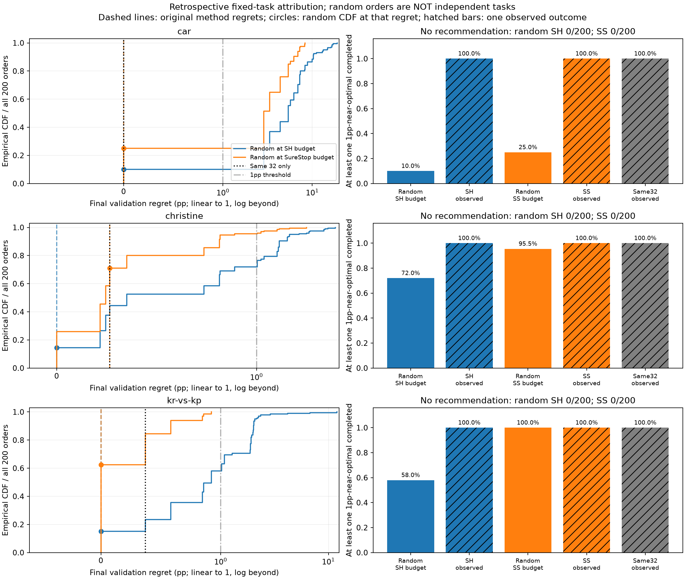

# 早停开发结果的限定收尾归因

2026年10月30日｜事后固定任务补充；原停止决定不变

本补充仅使用car、christine、kr-vs-kp三个原开发演示任务的v2缓存和六个原SH/SureStop结果文件。没有重抽候选，没有新增任务、训练、模型、权重或正式评价。三记录种子的验证误差取均值，记录时间求和，终点50轮、1pp近优、α=.1、τ=20pp、节点1/5/15/30/50均不变。成本单位为原记录elapsed seconds，不是本机训练CPU或实测加速。

**核心结论：三个任务的原32个完整候选本身都已保留至少一个1pp近优，足以解释SureStop原来的0/3近优丢失。** 后续96个只在kr-vs-kp使最终遗憾再降0.371357pp，支付9987.732记录秒；car和christine无新增选择改善，仍分别支付541.436和705.792秒。不能据此说前缀信息普遍无效：同成本随机结果显示SH的池内最佳选择较难仅由随机训练解释，但仍只是固定任务的描述。

## A：原32个完整候选与后续96个的新增收益

32个身份来自原SureStop付款账本purpose=calibration的完整付款，核对了32个唯一ID、node4及原结果的完成位置，并与原池前32个一致。没有删除这些候选或改写原SureStop的0/3任务失败结果。所有配置身份及组别在[attribution.csv](attribution.csv)中完整登记。

| 固定任务 | 32组最佳ID | 32组遗憾pp | 32组近优数/全池 | SureStop最终遗憾pp | 后续新增改善pp | 32完整成本秒 | 后续新增成本秒 |
|---|---|---:|---:|---:|---:|---:|---:|
| car | 1319 | 0.000000 | 1/1 | 0.000000 | 0.000000 | 7411.897 | 541.436 |
| christine | 758 | 0.264887 | 3/9 | 0.264887 | 0.000000 | 160805.896 | 705.792 |
| kr-vs-kp | 1319 | 0.371357 | 1/6 | 0.000000 | 0.371357 | 7960.258 | 9987.732 |

- **car**：全池最低误差9.267604pp；池内最佳位于32组['1319']、后续组[]。1pp近优在两组分别1与0个。仅32组的近优保留为1；后续96组另完成2个，最终选择1319（calibration），遗憾下降0.000000pp。新增费用由前缀423.943秒与补完117.492秒构成。
- **christine**：全池最低误差26.671934pp；池内最佳位于32组[]、后续组['308']。1pp近优在两组分别3与6个。仅32组的近优保留为1；后续96组另完成0个，最终选择758（calibration），遗憾下降0.000000pp。新增费用由前缀705.792秒与补完0.000秒构成。
- **kr-vs-kp**：全池最低误差3.727998pp；池内最佳位于32组[]、后续组['1493']。1pp近优在两组分别1与5个。仅32组的近优保留为1；后续96组另完成52个，最终选择1493（later），遗憾下降0.371357pp。新增费用由前缀6077.109秒与补完3910.623秒构成。

以上“新增改善”是原方法后续探索相对同一32组参考的实际选择改善，包含更多候选机会、前缀筛选和资源分配的共同效果；不能仅凭该分解给前缀信息一个普适因果贡献百分比。若32组已足以保存近优，该任务的近优保留成功无需后续96组才能实现；即便终点误差继续改善，也要和1pp事件分开。

## B：同成本随机完整训练

每个任务固定200个随机排列，seed=20261030，NumPy PCG64及SeedSequence派生方式、完整600个排列在[plan.json](plan.json)与[orders.json](orders.json)中。先执行prepare，只从缓存构造任务/ID，不按质量或成本生成顺序；同任务两预算使用同200个排列以配对，但每次都建立新环境独立回放，没有借大预算轨迹给小预算提供信息。

两个预算分别直接取原SH、SureStop的recorded_training_seconds，属于事后匹配，不是前瞻盲验证。策略只给出下一个ID；环境在该ID被请求后用其缓存成本模拟完成时刻。预算不足时消耗全部余额，不返回该候选终点，立即停止，不跳过它寻找便宜候选。已完成候选中验证终点最佳者才可推荐。无完成候选则无推荐、任务失败，遗憾undefined；排序/CDF按+∞保留，分母始终200。分位数取全部200结果的逆经验CDF（nearest-rank），不插值、不排除无推荐。

| 固定任务/预算 | 预算秒 | 随机遗憾Q05 / 中位 / Q95 pp | 保留近优/200 | 无推荐/200 | 完成数min / 中位 / max | 实际支出范围秒 |
|---|---:|---|---:|---:|---|---|
| car / sh | 3709.658 | 0.00000 / 5.36698 / 13.22953 | 20/200 | 0/200 | 8 / 18 / 25 | 3709.658–3709.658 |
| car / surestop | 7953.333 | 0.00000 / 2.86150 / 7.23670 | 50/200 | 0/200 | 23 / 37 / 50 | 7953.333–7953.333 |
| christine / sh | 78747.768 | 0.00000 / 0.35074 / 1.52814 | 144/200 | 0/200 | 10 / 17 / 26 | 78747.768–78747.768 |
| christine / surestop | 161511.687 | 0.00000 / 0.24474 / 0.89085 | 191/200 | 0/200 | 27 / 35 / 45 | 161511.687–161511.687 |
| kr-vs-kp / sh | 3772.021 | 0.00000 / 0.92118 / 2.06775 | 116/200 | 0/200 | 4 / 17 / 24 | 3772.021–3772.021 |
| kr-vs-kp / surestop | 17947.990 | 0.00000 / 0.00000 / 0.84820 | 200/200 | 0/200 | 64 / 77 / 94 | 17947.990–17947.990 |

[全部1200次回放](random_budget_comparison.csv)包含完成ID、未完成ID及其已付成本、支出、推荐、遗憾和失败；[分布汇总](random_summary.json)还给出最小/最大/Q25/Q75、仅有推荐者的均值（明确是条件均值）及完成数均值。没有把200个随机顺序当新增独立任务。

| 固定任务/原方法 | 原方法遗憾pp | 随机更好 / 相同 / 更差（分母200） | 随机ECDF在原方法遗憾处F(r) | 原方法完成数 |
|---|---:|---|---:|---:|
| car / sh | 0.000000 | 0 / 20 / 180 | 0.100 | 8 |
| car / surestop | 0.000000 | 0 / 50 / 150 | 0.250 | 34 |
| christine / sh | 0.000000 | 0 / 29 / 171 | 0.145 | 8 |
| christine / surestop | 0.264887 | 117 / 25 / 58 | 0.710 | 32 |
| kr-vs-kp / sh | 0.000000 | 0 / 30 / 170 | 0.150 | 8 |
| kr-vs-kp / surestop | 0.000000 | 0 / 125 / 75 | 0.625 | 84 |

F(r)是随机回放遗憾不高于原方法的比例，越小表示原结果越难由该随机基线达到；它不是p值、置信区间或任务总体风险保证。同池近优可能很多，因此“随机保留近优”与“随机恰好达到最佳终点”不能混说。

## 归因结论与限制

- **car**：同一32组已能解释1pp近优保留；后续实际提供0.000000pp改善、支付541.436秒。随机在SH预算下近优保留10.0%，在SureStop预算下25.0%；原策略在各自预算下均保留近优。更细的终点优势由上表胜/平/负区分。
- **christine**：同一32组已能解释1pp近优保留；后续实际提供0.000000pp改善、支付705.792秒。随机在SH预算下近优保留72.0%，在SureStop预算下95.5%；原策略在各自预算下均保留近优。更细的终点优势由上表胜/平/负区分。
- **kr-vs-kp**：同一32组已能解释1pp近优保留；后续实际提供0.371357pp改善、支付9987.732秒。随机在SH预算下近优保留58.0%，在SureStop预算下100.0%；原策略在各自预算下均保留近优。更细的终点优势由上表胜/平/负区分。

A把已完成参考本身的收益与后续新增选择收益/成本分开；B回答同样实际预算下的随机完整训练能解释多少。它们不是对“是否使用前缀”的随机化因果实验，且没有单独固定完成数、开销及候选机会来识别纯信息效应。SH与随机的差异只能作为这三个固定池中前缀指导资源分配的描述性证据。SureStop在32组之外的改善也不能一概归功于预测器。没有据结果换预算、增种子、调阈值或扩大任务。

原策略结果、0/3失败记录、alpha/tau/1pp规则及原停止决定均不改。补充完成即停止，不恢复新算法开发或正式评价。



左图CDF分母200，无推荐质量在+∞，不画成有限点；横轴0–1pp线性，之后对数。虚线是原方法终点遗憾，圆点是其在随机CDF的位置，黑点线为同一32组遗憾。右图实色随机比例来自200个顺序，斜线条是单个原策略/32组观测0或1，不是可交换的独立样本或概率保证。

## 重放与实际版本

```powershell
Set-Location <your-clone-directory>
$env:PYTHONDONTWRITEBYTECODE=1
$env:OMP_NUM_THREADS=1
.\.venv\Scripts\python.exe -B analysis_addendum_v1\run_addendum.py prepare
.\.venv\Scripts\python.exe -B analysis_addendum_v1\run_addendum.py run
```

上述prepare/run均在本次实际执行成功，直接重复会被覆盖保护拒绝。安全重放入口如下；name必须为新的子目录名，所有重放产物仍留在本补充目录内：

```powershell
.\.venv\Scripts\python.exe -B analysis_addendum_v1\replay_addendum.py --name replay_verification_v1
```

此命令已实际成功执行；该名字现已占用，今后重放请使用另一个新名字。固定排列、两张CSV和分布汇总四项逐字节一致，见[确定性重放核对](replay_verification_v1/replay_check.json)。没有增加新的200次顺序或把重放当新样本；两次计量CPU合计16.015625秒（驱动及终端工具开销不作精确总量声称），远低于600秒。原分析及重放输入指纹均保持一致，原分析结果不覆盖。重放驱动版本也记录在该核对中。

Python 3.12.14 (main, Aug 25 2026, 14:01:42) [MSC v.1944 64 bit (AMD64)]；NumPy 2.3.5；ijson 3.6.0；Matplotlib 3.11.2。脚本SHA256=871988b2a9e45855c4c792d4a44711560a39216385e88c841d8c5723c0af5388，排列SHA256=6568e2f272349496b9171f690db29d195a209488a608ae2295861827b3891f50。prepare CPU 0.718750秒，分析/作图进程CPU 7.656250秒，合计8.375000秒，限额600秒。输入/实际环境详情见[run_manifest.json](run_manifest.json)。

只核对了本次读取的缓存、六个结果、两个原策略代码及原规则前后指纹一致；不声称审计了整个研究目录。缓存物理上包含六任务，流式选择仅构造三个指定任务对象，其他任务数值令牌跳过，不进入本次计算、上下文、图表或汇总；未打开raw归档、旧CABOMB或旧隔离数据。部分成本/身份缺件会报错，不补默认值。本次全部必需字段可用。

合成实现检查：no cost look-ahead skipping；partial budget fully charged without endpoint；exact budget boundary completes candidate；unpaid label mutation leaves recommendation and path unchanged；zero-completion trial retained as failure。这些只验证预算/可见性语义，不是统计独立验证。
